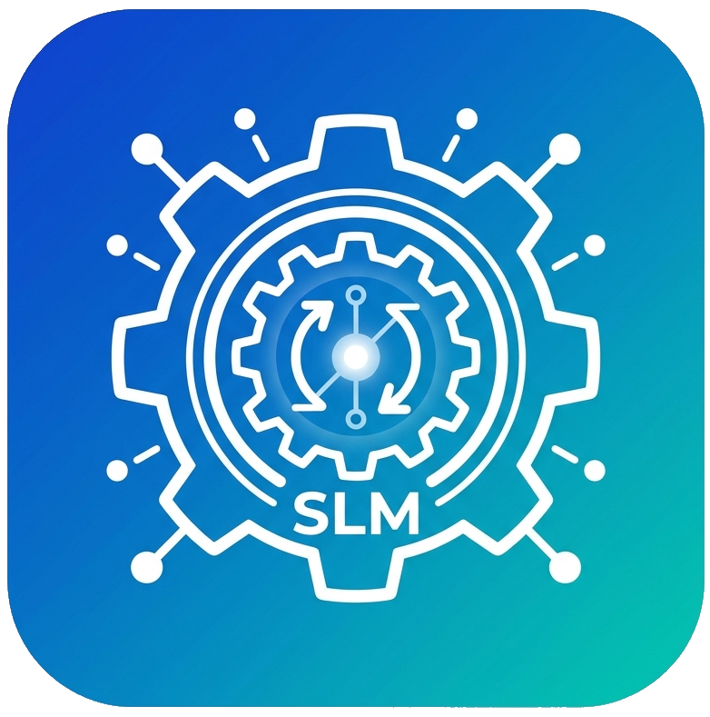
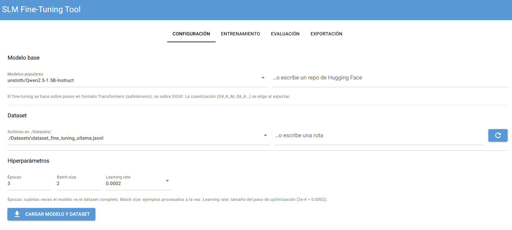

<p align="center">
  
</p>

# Automated SLM Fine-Tuning Tool



Pipeline automatizado para hacer *fine-tuning* (SFT + LoRA/QLoRA) de modelos de lenguaje pequeños (SLM) como `Qwen2.5-1.5B-Instruct`, exportar el resultado a **GGUF** cuantizado y registrarlo automáticamente en **Ollama**.

Diseñado para funcionar tanto en **GPU** (con Unsloth, ruta acelerada) como en **CPU** (con Transformers + PEFT, ruta *fallback*), sin necesidad de escribir scripts intermedios.

---

## 📋 Tabla de contenidos

- [Características](#-características)
- [Estado actual y roadmap](#-estado-actual-y-roadmap)
- [Requisitos](#-requisitos)
- [Instalación](#-instalación)
  - [1. Python](#1-python)
  - [2. Entorno virtual](#2-entorno-virtual)
  - [3. Dependencias base](#3-dependencias-base)
  - [4. Unsloth (opcional, solo GPU NVIDIA)](#4-unsloth-opcional-solo-gpu-nvidia)
  - [5. Ollama](#5-ollama)
  - [6. Herramientas de compilación (solo ruta CPU)](#6-herramientas-de-compilación-solo-ruta-cpu)
- [Formato del dataset](#-formato-del-dataset)
- [Uso](#-uso)
- [Pipeline paso a paso](#-pipeline-paso-a-paso)
- [Hardware recomendado](#-hardware-recomendado)
- [Solución de problemas](#-solución-de-problemas)
- [Estructura del proyecto](#-estructura-del-proyecto)
- [Licencia](#-licencia)

---

## ✨ Características

- ✅ **Fine-tuning con LoRA/QLoRA** usando `trl.SFTTrainer`.
- ✅ **Ruta GPU acelerada** con [Unsloth](https://github.com/unslothai/unsloth) (QLoRA 4-bit NF4 + doble cuantización).
- ✅ **Ruta CPU de *fallback*** con `transformers` + `peft` (sin necesidad de GPU).
- ✅ **Evaluación comparativa** antes y después del *fine-tuning* (`eval_loss` + generación cualitativa).
- ✅ **Exportación a GGUF cuantizado** (`q4_k_m`, `q8_0`, etc.) directamente para Ollama.
- ✅ **Generación automática del `Modelfile`** con parche contra el bug conocido de Unsloth ([issue #2604](https://github.com/unslothai/unsloth/issues/2604)).
- ✅ **Registro automático en Ollama** con un solo comando.
- ✅ **Limpieza automática** de archivos temporales pesados.

---

## 🚦 Estado actual y roadmap

Última actualización: 2026-11-17.

El proyecto es un prototipo funcional en evolución. La interfaz activa es `app_ui3.py`; el flujo completo con modelos reales aún necesita validarse en hardware objetivo antes de considerar estable la ruta de producción.

### Avances completados

- [x] Se estableció un único pipeline compartido y un solo trabajo pesado activo a la vez.
- [x] El progreso y la cancelación están aislados por trabajo; los errores producen un estado final y liberan la coordinación global.
- [x] Los checkpoints y exportaciones de cada ejecución usan directorios únicos.
- [x] El fallback CPU resuelve repositorios conocidos de Qwen, Llama, Gemma y Phi; la inferencia usa el dispositivo real de entrada del modelo.
- [x] Se declaró NiceGUI y se elevó el mínimo de TRL para ajustarlo a la API utilizada por el pipeline.
- [x] Se añadieron pruebas de regresión de estabilidad. Las 8 pruebas pasan; también pasan `py_compile` y Ruff.

### Roadmap

#### Fase 1 — Validar el flujo completo en hardware real

**Estado:** pendiente; es el siguiente hito.

- [ ] Ejecutar carga, evaluación inicial, entrenamiento, evaluación final y exportación/registro en Ollama con un dataset pequeño en CPU.
- [ ] Repetir el flujo en una GPU NVIDIA con la ruta Unsloth, si el hardware está disponible.
- [ ] Registrar sistema operativo, Python, versiones de dependencias, modelo, hardware, tiempos y artefactos generados.
- [ ] Confirmar que Ollama puede cargar y ejecutar el modelo exportado en cada perfil validado.

**Criterio de cierre:** al menos un recorrido completo y reproducible por cada perfil que se anuncie como compatible; los artefactos finales arrancan en Ollama y los errores/cancelaciones no dejan bloqueada la aplicación.

#### Fase 2 — Validar datasets y errores de entrada

**Estado:** pendiente.

- [ ] Definir y documentar el esquema soportado: `messages`, roles permitidos y contenido requerido.
- [ ] Añadir pruebas para JSON/JSONL válido, JSON malformado, ejemplos vacíos, campos ausentes y datasets pequeños sin split de evaluación.
- [ ] Comprobar que los mensajes de error identifican el archivo y la causa sin ocultar la excepción original.

**Criterio de cierre:** las entradas válidas se preparan con resultados esperados; las inválidas fallan antes del entrenamiento con errores accionables y pruebas de regresión.

#### Fase 3 — Reproducibilidad y compatibilidad de dependencias

**Estado:** pendiente.

- [ ] Probar una instalación limpia usando `requirements.txt` en cada sistema operativo/perfil de hardware que se quiera soportar.
- [ ] Confirmar una matriz compatible de Python, PyTorch, Transformers, TRL, PEFT y Unsloth; no anunciar combinaciones que no se hayan probado.
- [ ] Generar un lockfile por perfil cuando las versiones verificadas estén acordadas.
- [ ] Mantener en este README los comandos de instalación e inicio de CLI y UI alineados con el entorno probado.

**Criterio de cierre:** una instalación limpia puede iniciar la UI y completar las pruebas automatizadas con dependencias reproducibles para cada perfil publicado.

#### Fase 4 — Resiliencia y ciclo de vida de los trabajos

**Estado:** pendiente.

- [ ] Probar carga, entrenamiento, evaluación y exportación concurrentes desde varias pestañas; una segunda operación debe rechazarse claramente mientras la primera está activa.
- [ ] Probar éxito, fallo y cancelación para confirmar que el bloqueo se libera y el siguiente trabajo puede comenzar.
- [ ] Medir memoria y comprobar el estado del modelo tras fallos, cancelaciones y cambio de dataset.
- [ ] Evitar capturas globales de `stdout` para resultados de trabajos y preferir resultados/logs ligados a cada ejecución.

**Criterio de cierre:** pruebas de integración cubren el ciclo de vida completo y no hay mensajes cruzados, bloqueos huérfanos ni resultados mezclados entre trabajos.

#### Fase 5 — Preparación de una versión utilizable

**Estado:** pendiente.

- [ ] Publicar una tabla de perfiles probados con hardware, limitaciones y tiempos observados.
- [ ] Documentar rutas de salida, retención de checkpoints y comportamiento al registrar un nombre de Ollama existente.
- [ ] Revisar la guía de instalación, solución de problemas y licencia antes de etiquetar una versión.

**Criterio de cierre:** una persona nueva puede instalar, ejecutar un ejemplo, encontrar los resultados y entender las limitaciones sin depender de instrucciones externas.

### Verificación local actual

Desde la raíz del proyecto:

```bash
python -m unittest -v test_stability
python -m py_compile app_ui3.py slm_automator.py test_stability.py
ruff check app_ui3.py slm_automator.py test_stability.py
```

Estas comprobaciones validan pruebas, sintaxis y lint; **no sustituyen** una ejecución real de entrenamiento ni de exportación.

---

## 🧰 Requisitos

| Componente | Versión mínima | Notas |
|---|---|---|
| Python | 3.10 – 3.12 | 3.13 puede dar problemas con algunas dependencias |
| pip | 23.0+ | Recomendado actualizar |
| Ollama | última | Para registrar y ejecutar el modelo final |
| GPU NVIDIA (opcional) | 6–8 GB VRAM | Recomendado para la ruta Unsloth |
| Git | cualquiera | Solo para la ruta CPU (clonar `llama.cpp`) |
| CMake | 3.20+ | Solo para la ruta CPU (compilar `llama-quantize`) |

---

## 🚀 Instalación

### 1. Python

> ⚠️ **Importante en Windows**: si al ejecutar `python` te aparece el mensaje de la Microsoft Store (*"No se encontró Python; ejecutar sin argumentos para instalar..."*), es porque Windows tiene activado el **alias de ejecución de aplicaciones**. Solución:
>
> 1. Abre **Configuración** → **Aplicaciones** → **Configuración avanzada de aplicaciones** → **Alias de ejecución de aplicaciones**.
> 2. Desactiva los interruptores de **`python.exe`** y **`python3.exe`**.
> 3. Cierra y vuelve a abrir la terminal.
>
> Alternativa rápida mientras lo arreglas: usa `py` en lugar de `python` (por ejemplo, `py -m venv venv`).

Descarga Python desde [python.org](https://www.python.org/downloads/) y, durante la instalación, **marca la casilla "Add python.exe to PATH"**.

### 2. Entorno virtual

```bash
python -m venv venv

# Windows
venv\Scripts\activate

# Linux / macOS
source venv/bin/activate

Deberías ver (venv) al principio del prompt.

```
### 3. Dependencias base
Con el entorno virtual activado:

```bash
pip install -r requirements.txt
Si aún no tienes el requirements.txt, puedes instalarlas directamente:
```
```bash
pip install nicegui torch transformers datasets "trl>=1.18.0" peft accelerate numpy
```
### 4. Unsloth (opcional, solo GPU NVIDIA)

Unsloth no está incluido en requirements.txt porque su instalación depende de la plataforma y del backend de PyTorch. Instálalo por separado:

Windows:

```bash
pip install "unsloth[windows] @ git+https://github.com/unslothai/unsloth.git"
```
Linux:

```bash
pip install "unsloth[cu121] @ git+https://github.com/unslothai/unsloth.git"
El script detecta automáticamente si Unsloth está disponible y si hay GPU. Si no lo encuentra, usa la ruta CPU con transformers + peft.
```
### 5. Ollama
Descarga e instala Ollama desde ollama.com. Verifica que el servicio esté activo:

```bash
ollama list
```
### 6. Herramientas de compilación (solo ruta CPU)
Si vas a usar el modo CPU, necesitarás git y cmake para compilar llama-quantize. El script los detecta y los compila automáticamente la primera vez.

```text
Git: git-scm.com

CMake: cmake.org
```
## 📁 Formato del dataset
El dataset debe ser un archivo JSONL (o cargable desde Hugging Face) con una columna messages en formato de conversación:

```json
{"messages": [{"role": "system", "content": "Eres un asistente conciso."}, {"role": "user", "content": "¿Qué es LoRA?"}, {"role": "assistant", "content": "LoRA es una técnica de fine-tuning eficiente..."}]}
{"messages": [{"role": "user", "content": "Explícame QLoRA."}, {"role": "assistant", "content": "QLoRA combina LoRA con cuantización 4-bit..."}]}
```
## Requisitados:

Mínimo 10 ejemplos para que se realice el split de evaluación (por defecto 90/10).

Si tienes menos, el script entrenará sin conjunto de evaluación (y lo indicará).

La calidad del dataset importa más que la cantidad: 500 ejemplos buenos > 5.000 ejemplos ruidosos.

## ▶️ Uso

### Interfaz gráfica

Desde la raíz del proyecto, con las dependencias instaladas:

```bash
python app_ui3.py
```

La interfaz local queda disponible en `http://localhost:8080`.

## CLI

### Flujo completo
```python
from slm_automator import SLMFineTunerPipeline

prompts_prueba = ["¿Qué es LoRA y para qué sirve?"]

pipeline = SLMFineTunerPipeline(model_name="unsloth/Qwen2.5-1.5B-Instruct")
pipeline.load_model_and_tokenizer()
pipeline.prepare_dataset("mi_dataset.jsonl", test_size=0.1)
```

## 1. Evaluación baseline (antes del FT)
```python
pipeline.evaluate_model(test_prompts=prompts_prueba, stage_label="Baseline (Pre-FT)")
```

## 2. Entrenamiento
```python
pipeline.train(epochs=3, batch_size=2, learning_rate=2e-4)
```

## 3. Evaluación post-FT (comparativa)
```python
pipeline.evaluate_model(test_prompts=prompts_prueba, stage_label="Post-FT")
```

## 4. Exportación GGUF + Modelfile y registro en Ollama
```python
modelfile = pipeline.export_to_gguf(export_dir="./gguf_output", quant_type="q4_k_m")
pipeline.register_in_ollama(modelfile, ollama_model_name="qwen2.5-ft")
```
Ejecutar el modelo final
```bash
ollama run qwen2.5-ft
```
### 🔄 Pipeline paso a paso

| Paso | Método | Qué hace |
|---:|---|---|
| 1 | `load_model_and_tokenizer()` | Carga el modelo base con Unsloth (GPU) o Transformers+PEFT (CPU). Configura LoRA. |
| 2 | `prepare_dataset()` | Carga el JSONL, aplica la plantilla de chat de Qwen2.5, valida `eos_token` y divide en train/eval. |
| 3 | `evaluate_model()` | Calcula `eval_loss` en el conjunto de validación y genera respuestas cualitativas. |
| 4 | `train()` | Ejecuta SFT con `SFTTrainer`. Ajusta automáticamente `bf16`/`fp16`. |
| 5 | `evaluate_model()` | Repite la evaluación para comparar con el baseline. |
| 6 | `export_to_gguf()` | Fusiona LoRA, cuantiza a GGUF y genera/corrige el `Modelfile`. |
| 7 | `register_in_ollama()` | Ejecuta `ollama create` con el `Modelfile` generado. |

### 💻 Hardware recomendado

| Escenario | GPU | VRAM | RAM | Rendimiento esperado |
|---|---|---|---:|---|
| Ruta Unsloth (GPU) | RTX 3060 / 4050 / 4060 | 6–8 GB | 8 GB | ~5–10 min para 500 ejemplos × 3 épocas |
| Ruta Unsloth (GPU alta) | RTX 4070 / 4080 | 12+ GB | 16 GB | ~2–4 min; puedes subir `batch_size` a 4 u 8 |
| Ruta CPU (fallback) | — | — | 16 GB | ~1–3 horas para 500 ejemplos × 3 épocas |

> **Nota:** El script detecta automáticamente si hay GPU. Si no la hay, activa el modo CPU sin intervención manual.

## 🛠️ Solución de problemas
### ❌ python no se encuentra en el PATH
Síntoma:

'''text
No se encontró Python; ejecutar sin argumentos para instalar desde la Microsoft Store...
Causa: Los alias de ejecución de Windows interceptan python y python3.

Solución:

Configuración → Aplicaciones → Configuración avanzada de aplicaciones → Alias de ejecución de aplicaciones.

Desactiva python.exe y python3.exe.

Reinicia la terminal.

Alternativa rápida: usa py en lugar de python.

### ❌ ModuleNotFoundError: No module named 'datasets'
Causa: El entorno virtual no tiene las dependencias instaladas.

Solución:

```bash
pip install -r requirements.txt
O manualmente:
```
```bash
pip install nicegui torch transformers datasets "trl>=1.18.0" peft accelerate numpy
❌ ModuleNotFoundError: No module named 
'unsloth'
```
Causa: Unsloth no está instalado (o no es compatible con tu plataforma).

Solución: Si tienes GPU NVIDIA, instálalo con el comando específico de tu plataforma (ver Instalación). Si no tienes GPU, puedes ignorar este error: el script usará automáticamente el modo CPU.

### ❌ UserWarning: Failed to initialize NumPy
Causa: Falta numpy en el entorno.

Solución:

```bash
pip install numpy
❌ ollama: command not found
Causa: Ollama no está instalado o no está en el PATH.
```
Solución: Instala Ollama desde ollama.com y verifica con ollama list.

### ❌ El Modelfile generado por Unsloth apunta al archivo equivocado
Síntoma: Ollama carga el modelo en F16 (pesado) en lugar del cuantizado Q4_K_M.

Causa: Bug conocido de Unsloth (issue #2604).

Solución: El script ya incluye el parche que reescribe la línea FROM del Modelfile para que apunte al GGUF cuantizado correcto. Si ves este problema, asegúrate de estar usando la versión más reciente del script.

### ❌ Error al compilar llama-quantize en la ruta CPU
Síntoma: subprocess.CalledProcessError durante cmake --build.

Causa: Falta CMake o un compilador C++.

Solución: Instala CMake y un compilador (MSVC en Windows, build-essential en Linux).

### ❌ Entrenamiento extremadamente lento en CPU
Causa: La ruta CPU no usa cuantización y el modelo se carga en FP32.

Solución: Es esperado. Para acelerar:

Reduce epochs a 1–2.

Reduce max_seq_length.

Usa un dataset más pequeño.

Si tienes GPU, instala Unsloth.

---

### 📂 Estructura del proyecto
```text
Autonated SLM Fine-Tuning Tool/
├── slm_automator.py          # Script principal (clase SLMFineTunerPipeline)
├── requirements.txt          # Dependencias base
├── README.md                 # Este archivo
├── mi_dataset.jsonl          # Tu dataset de entrenamiento
├── output_model/             # Salida del entrenamiento (checkpoints)
└── gguf_output/              # GGUF cuantizado + Modelfile
```
📄 requirements.txt recomendado
```txt
nicegui>=2.0
torch>=2.0
transformers>=4.40
datasets>=2.18
trl>=1.18.0
peft>=0.10
accelerate>=0.28
numpy>=1.24

```
Unsloth no se incluye aquí porque su instalación depende de la plataforma. Consulta la sección Unsloth.

Para máxima reproducibilidad de tu entorno exacto:

```bash
pip freeze > requirements.lock.txt
```
### ⚖️ Uso responsable
Esta herramienta está pensada para:

Fine-tuning de asistentes internos con datos propios.

Clasificación y extracción de información en dominios acotados.

Prototipado rápido de modelos especializados.

### 📖 Investigación educativa.

No la uses para generar contenido dañino, eludir sistemas de seguridad o crear modelos sin auditoría en entornos de producción críticos.

### 📜 Licencia
Apache 2.0. Los pesos del modelo base están sujetos a sus respectivas licencias de origen (Qwen2.5: Apache 2.0; Unsloth: Apache 2.0).

---
